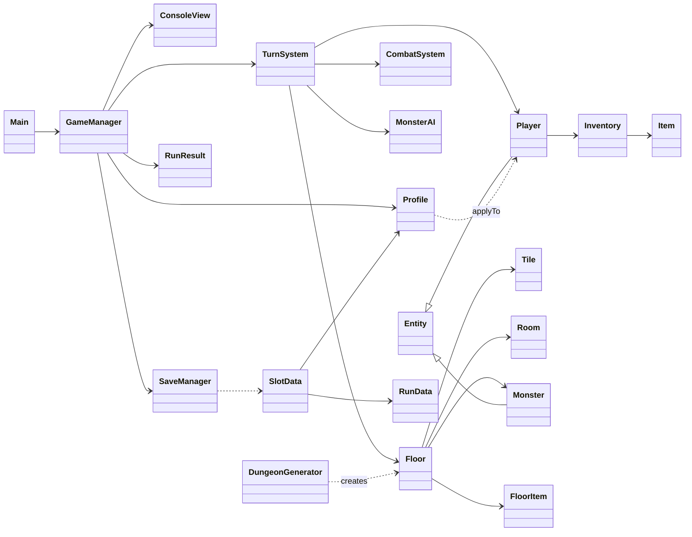
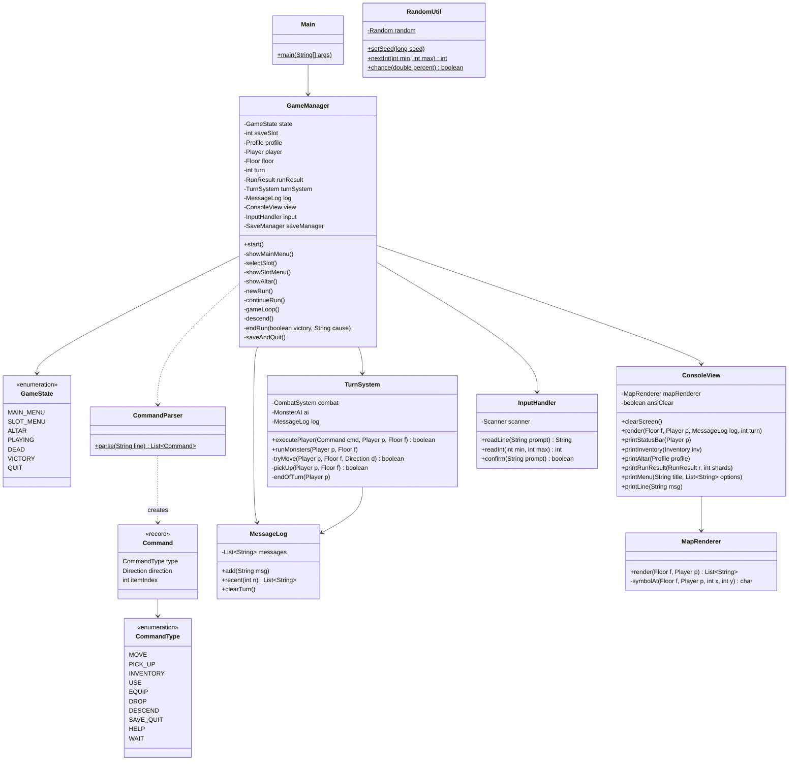
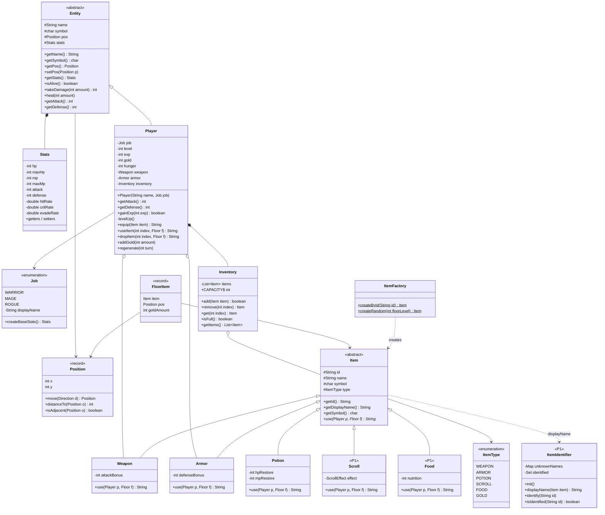
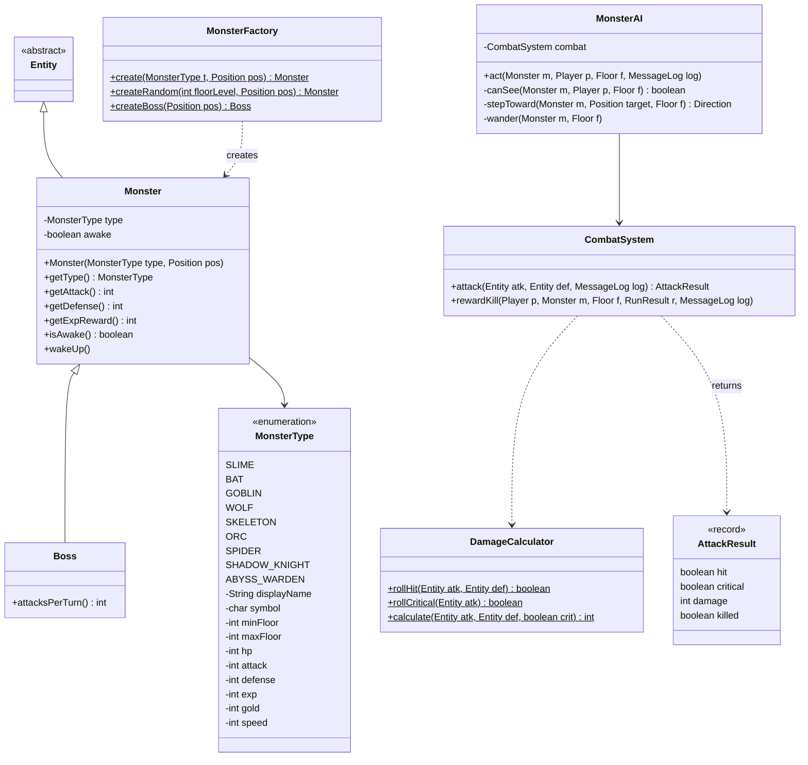
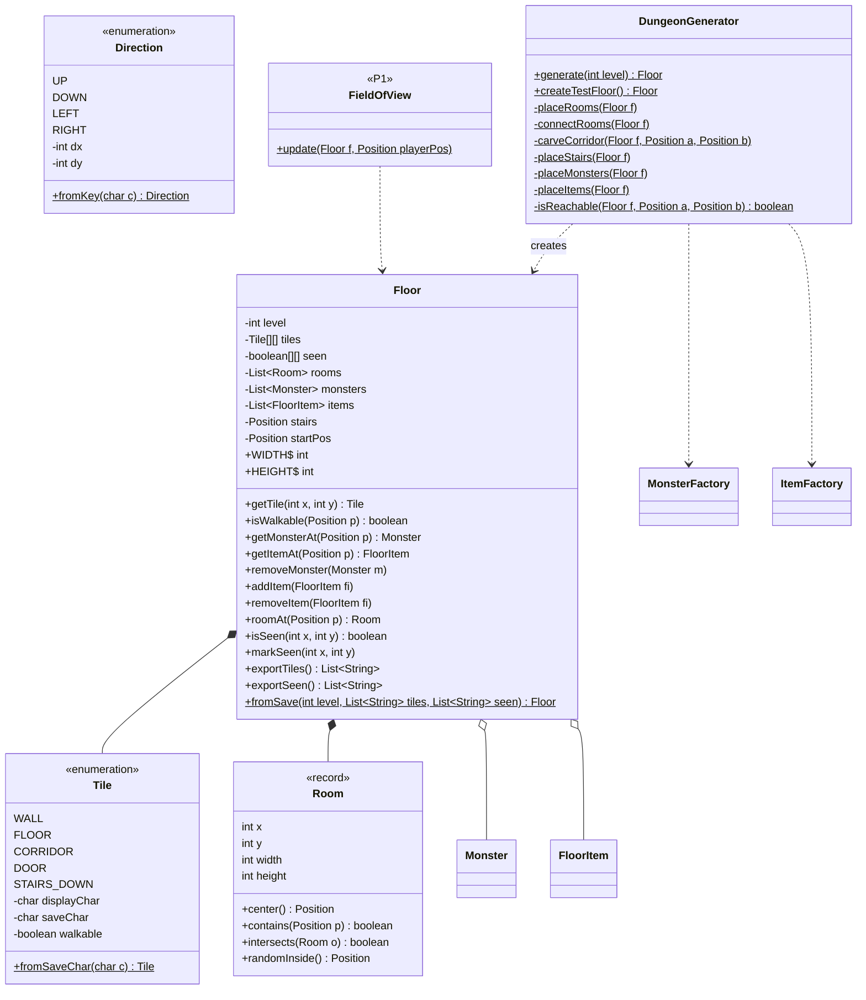
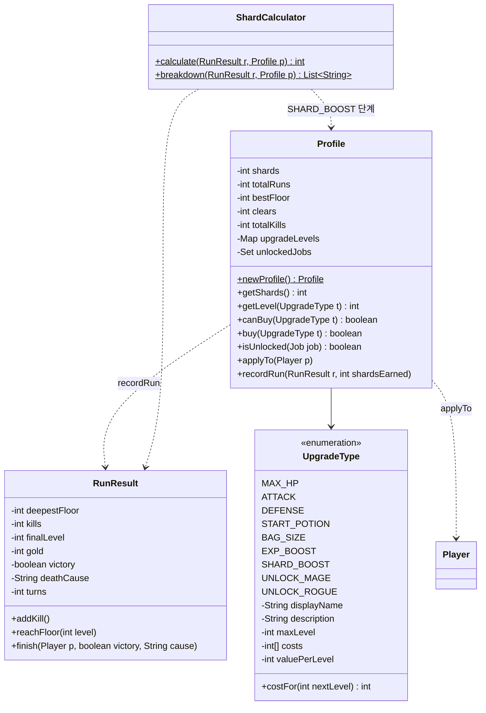
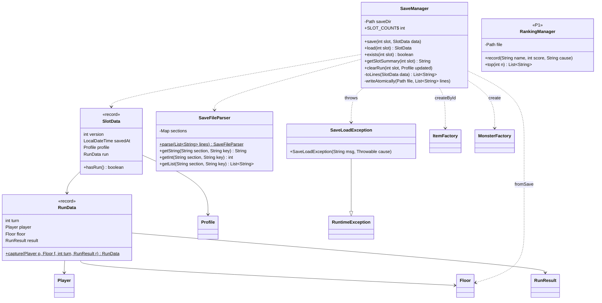
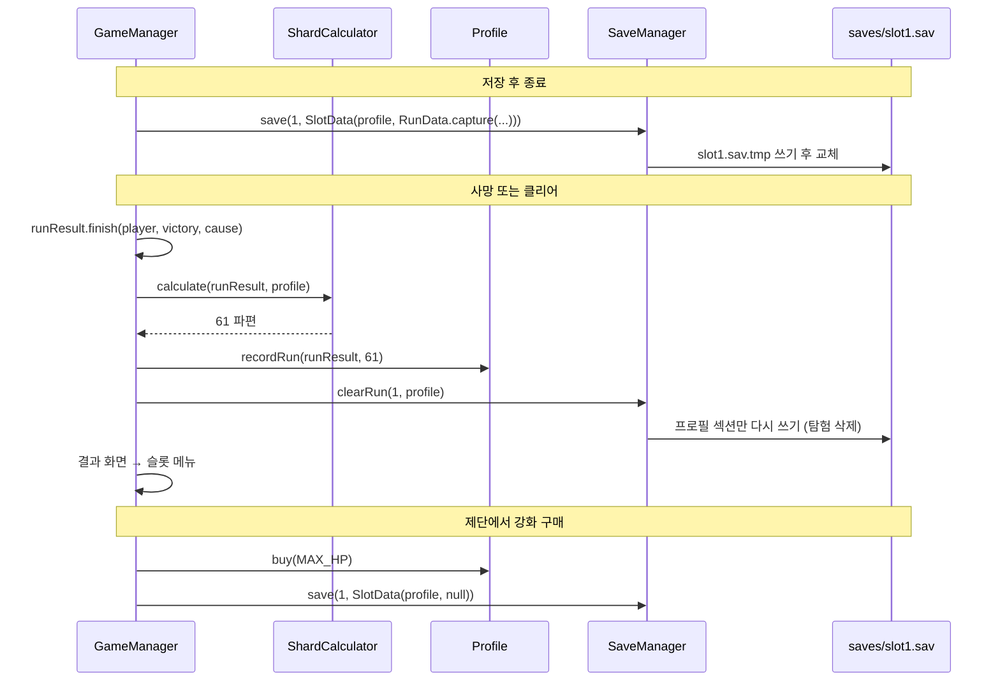
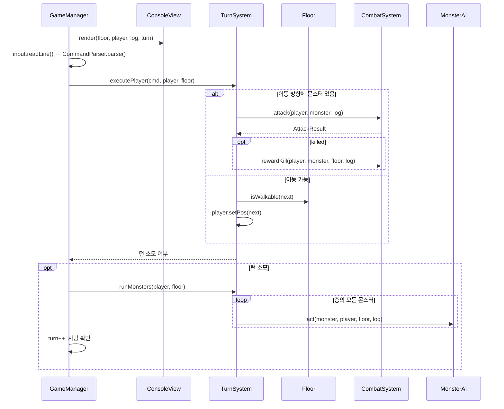

# 클래스 다이어그램 (v2.1, 로그라이크 + 로그라이트 영구 성장)

> 기획서: [Project-Plan.md](./Project-Plan.md) · Mermaid `classDiagram` 형식 (GitHub, IntelliJ Mermaid 플러그인에서 렌더링)
> 표기: `+` public, `-` private, `#` protected, `*` abstract 메서드, `$` static, `<<P1>>` 추가 기능

## 1. 전체 구조

| 파트 | 담당 | 클래스 |
|---|---|---|
| A | 게임 루프·UI·세이브 | Main, GameManager, GameState, TurnSystem, Command, CommandParser, MessageLog, ConsoleView, MapRenderer, InputHandler, RandomUtil, SaveManager, SlotData, RunData, SaveFileParser, SaveLoadException, RankingManager(P1) |
| B | 캐릭터·아이템·영구 성장 | Entity, Position, Player, Job, Stats, Item, Weapon, Armor, Potion, Scroll(P1), Food(P1), ItemType, Inventory, FloorItem, ItemFactory, ItemIdentifier(P1), Profile, UpgradeType, RunResult, ShardCalculator |
| C | 몬스터·전투 | Monster, Boss, MonsterType, MonsterFactory, MonsterAI, CombatSystem, DamageCalculator, AttackResult |
| D | 맵·생성 | Floor, Tile, Room, Direction, DungeonGenerator, FieldOfView(P1) |

---

## 2. 게임 루프 · UI (A 파트)

> `MapRenderer.symbolAt()` 우선순위: 플레이어 `@` → 몬스터 기호 → 바닥 아이템 기호 → 타일 기호. P1 시야 적용 시 안 본 칸은 공백, 본 적 있지만 지금 안 보이는 칸은 타일만(몬스터 숨김).

---

## 3. 캐릭터 · 아이템 (B 파트)

> `use()`는 결과 문장을 돌려주고, `TurnSystem`이 그 문장을 `MessageLog`에 넣는다. Weapon/Armor의 `use()`는 장착, Potion/Scroll/Food는 효과 적용 후 가방에서 제거.

---

## 4. 몬스터 · 전투 (C 파트)

> 데미지: 명중 실패 시 0 → `max(1, 공격 - 방어) × 0.9~1.1` → 치명타 시 ×1.5.
> AI 규칙: 깨어 있지 않으면 대기, 플레이어가 같은 방 또는 6칸 이내면 깨어남. 깨어 있으면 인접 시 공격, 아니면 x·y 중 거리가 큰 축으로 한 칸 이동(막히면 다른 축). `speed`가 2면 2번 행동, 슬라임처럼 느린 몬스터는 짝수 턴에만 행동.

---

## 5. 맵 · 던전 생성 (D 파트)

> 생성 절차: ① 전부 WALL로 채움 → ② 크기 4~12 x 3~6인 방을 겹치지 않게 최대 50회 시도해 6~9개 배치 → ③ 방을 x좌표순 정렬 후 i번 ↔ i+1번 중심을 L자 복도로 연결, 방 경계와 만나는 칸은 DOOR → ④ 첫 방에 시작 위치, 마지막 방에 계단(5층은 보스) → ⑤ 시작 방 외 방들에 몬스터·아이템 배치 → ⑥ BFS로 시작 → 계단 도달 확인, 실패 시 재생성.

---

## 6. 영구 성장 · 로그라이트 (B 파트, 필수)

> 흐름: 새 탐험 → `new Player(name, job)` → `profile.applyTo(player)` (HP·공격·방어 증가, 시작 물약 지급, 가방 칸 증가) → 탐험 중 `RunResult`에 처치·도달 층 누적 → 사망/클리어 시 `ShardCalculator.calculate()` → `profile.recordRun()` → 탐험 섹션 삭제 후 저장.
> 경험치 강화(P1)는 `Player.gainExp()`가 받는 값에 배율을 곱한다. 배율은 `applyTo()`에서 `Player`에 넣어 둔다.

---

## 7. 세이브 / 로드 (A 파트, 필수)

**파일 구조**: 프로필 섹션 `[META]`, `[PROFILE]`, `[UPGRADES]`는 항상 있고, 탐험 섹션 `[RUN]`, `[PLAYER]`, `[INVENTORY]`, `[IDENTIFY]`(P1), `[FLOOR]`(타일·탐험 20줄씩), `[MONSTERS]`, `[ITEMS]`는 진행 중인 탐험이 있을 때만 쓴다.

**저장 시점**
- 슬롯 처음 생성, 제단에서 강화 구매, 탐험 시작 직후, `S` 저장 후 종료, 사망·클리어 직후
- 항상 `slotN.sav.tmp`에 쓰고 `slotN.sav`로 원자적 교체

**이어하기**
1. 슬롯 요약 출력 (예: `1) 파편 85 | 최고 3층 | 탐험 6회 | 진행 중: 용사 Lv.3 전사 지하 2층`, 빈 슬롯은 `(새 슬롯)`)
2. `Files.readAllLines()` → `SaveFileParser.parse()` → `SlotData`
3. `hasRun()`이면 `Floor.fromSave()`로 맵 복원 → `MonsterFactory.create(type, pos)` 후 HP 덮어쓰기 → `ItemFactory.createById()`로 바닥·가방·장비 복원
4. 실패 시 `SaveLoadException` → 안내 후 메인 메뉴 (탐험 섹션만 손상이면 프로필만 살릴지 확인)

**영구 죽음 + 영구 성장**
- `GameManager.endRun()`: `runResult.finish()` → 파편 계산 → `profile.recordRun()` → `saveManager.clearRun(slot, profile)` (탐험 섹션 없이 프로필만 다시 씀) → 결과 화면 → 슬롯 메뉴

---

## 8. 핵심 시퀀스: 한 턴의 흐름

