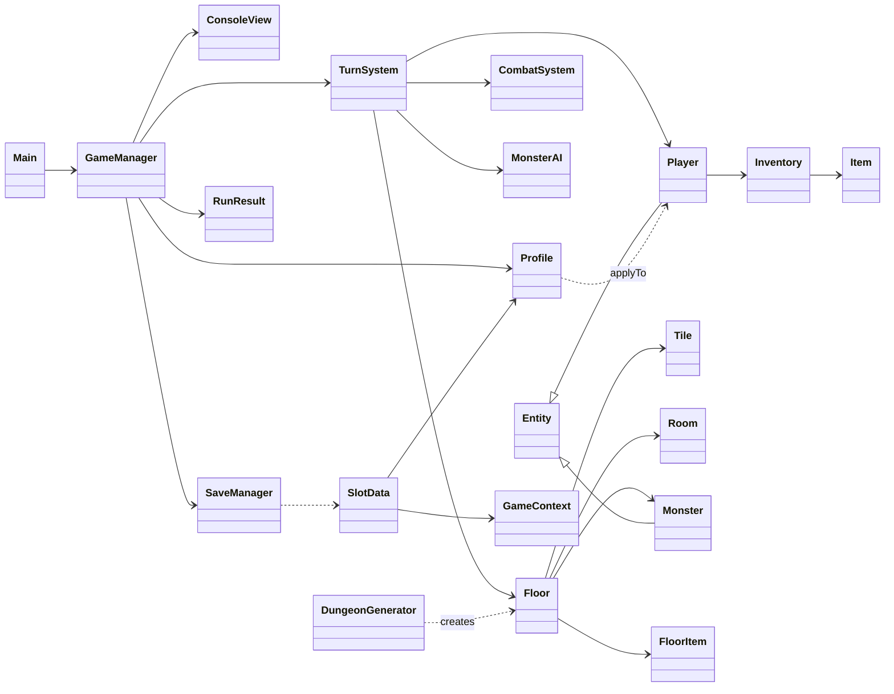
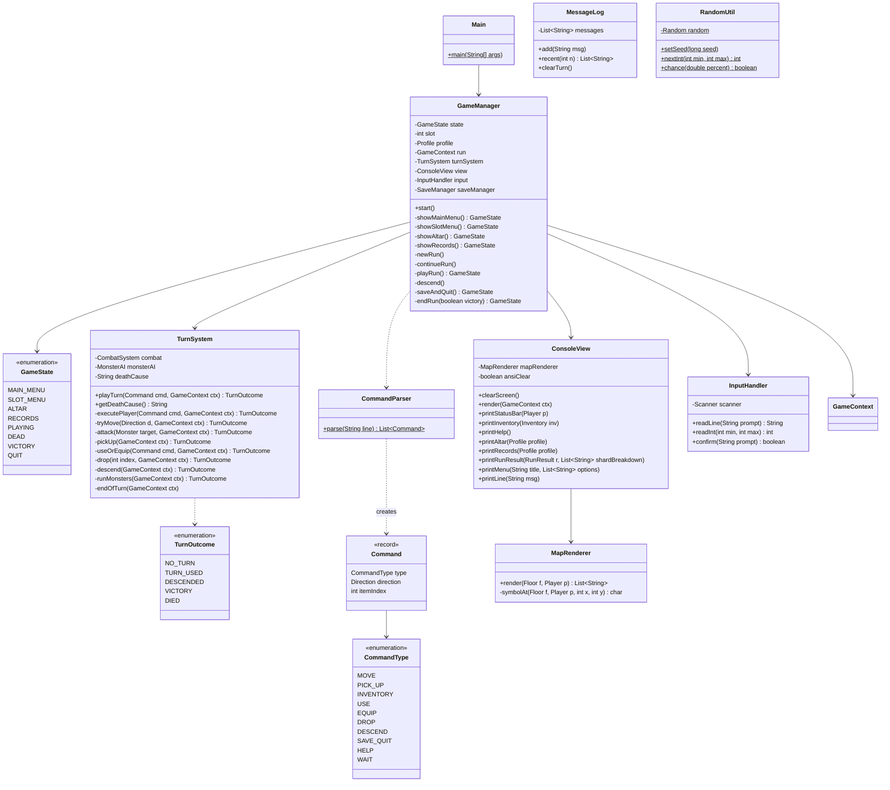
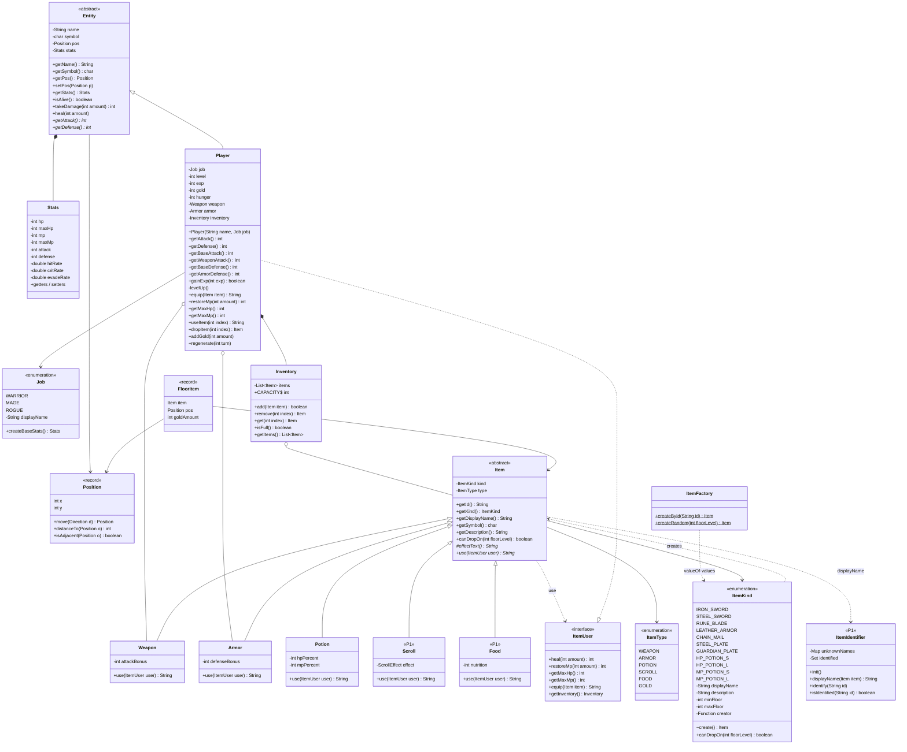
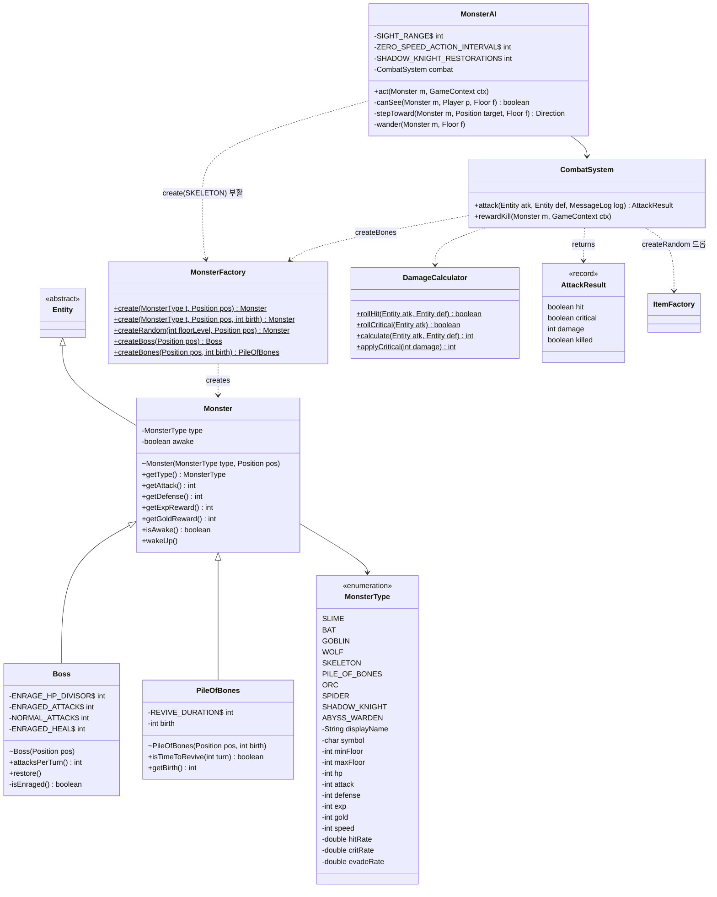
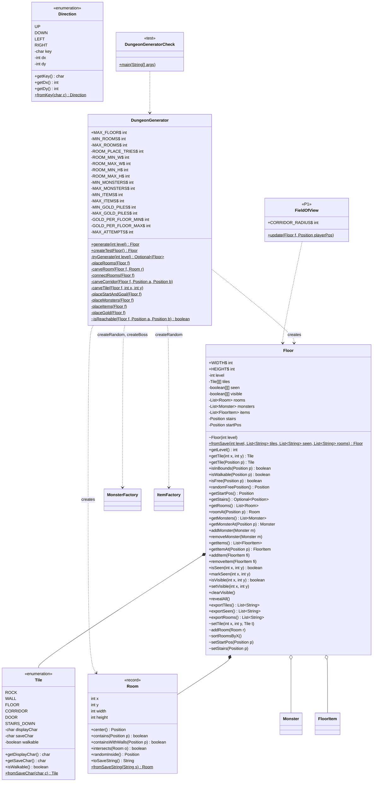
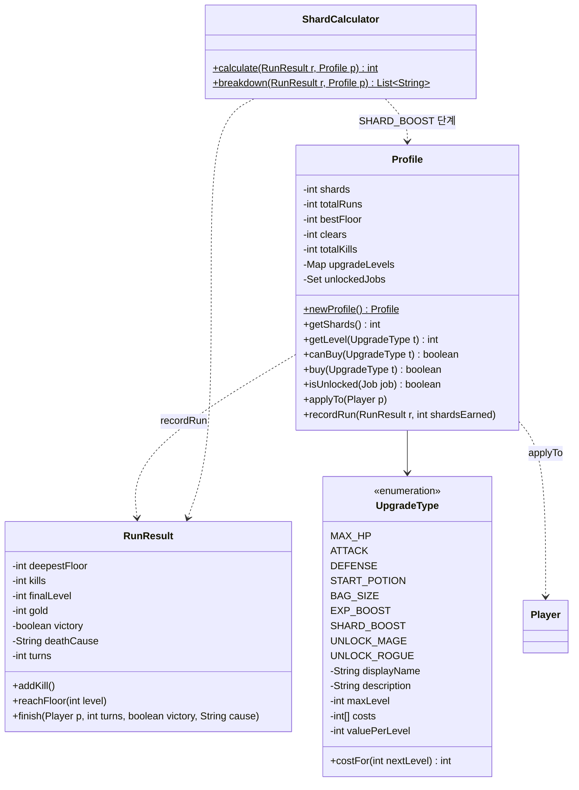
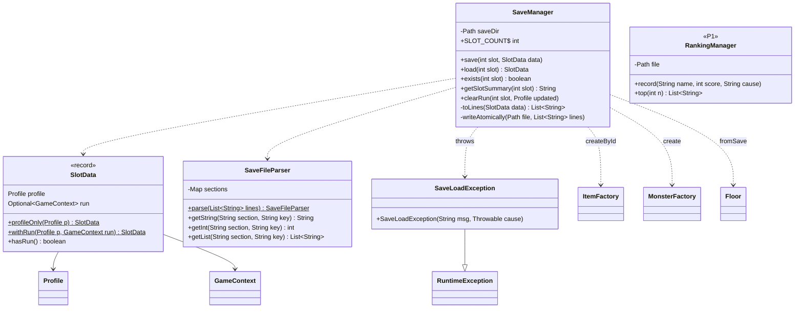
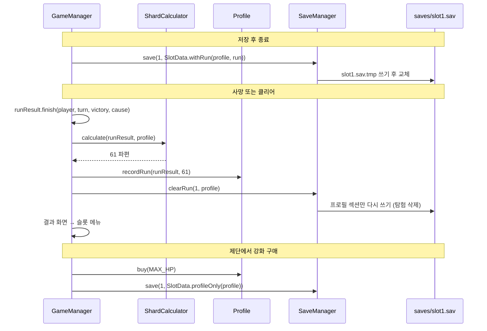
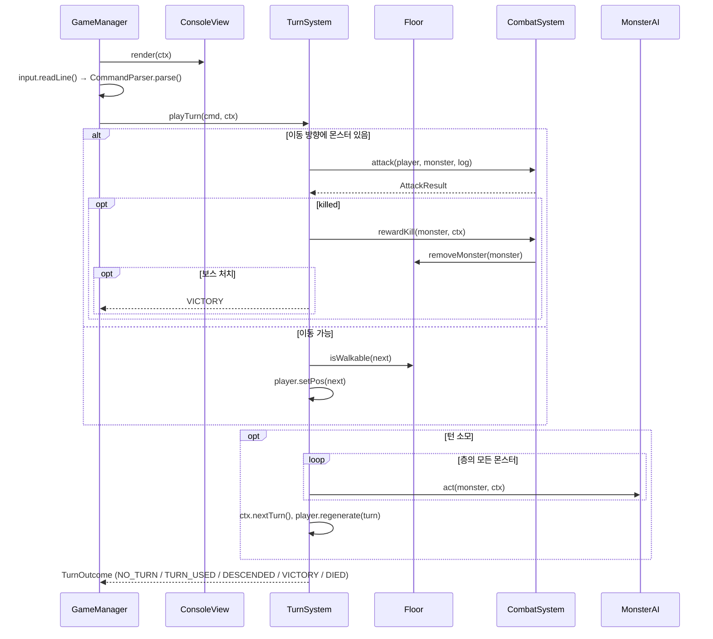

# 클래스 다이어그램 (v2.1, 로그라이크 + 로그라이트 영구 성장)

> 기획서: [Project-Plan.md](./Project-Plan.md) · Mermaid `classDiagram` 형식 (GitHub, IntelliJ Mermaid 플러그인에서 렌더링)
> 표기: `+` public, `-` private, `#` protected, `~` package-private, `*` abstract 메서드, `$` static, `<<P1>>` 추가 기능

## 1. 전체 구조

| 파트 | 담당 | 클래스 |
|---|---|---|
| A | 게임 루프·UI·세이브 | Main, GameManager, GameState, TurnSystem, Command, CommandParser, ConsoleView, MapRenderer, InputHandler, RandomUtil, SaveManager, SlotData, SaveFileParser, SaveFileWriter, SaveLoadException, TurnOutcome, RankingManager(P1) |
| B | 캐릭터·아이템·영구 성장 | Entity, Player, Job, Stats, Item, ItemKind, Weapon, Armor, Potion, Scroll(P1), Food(P1), ItemType, ItemUser, Inventory, FloorItem, ItemFactory, ItemIdentifier(P1), Profile, UpgradeType, RunResult, ShardCalculator |
| C | 몬스터·전투 | Monster, Boss, PileOfBones, MonsterType, MonsterFactory, MonsterAI, CombatSystem, DamageCalculator, AttackResult |
| D | 맵·생성 | Floor, Tile, Room, DungeonGenerator, FieldOfView(P1), DungeonGeneratorCheck(검증용, `src/test/java`) |
| 공통 | `core` 패키지 (수정 전 팀 공유) | Position, Direction, MessageLog |
| 공통 | `context` 패키지 (수정 전 팀 공유) | GameContext |

> **`core` 패키지:** 여러 파트가 함께 쓰는 타입을 모은다. 아래 다이어그램에서는 처음 쓰는 파트 쪽에 그려 두었지만 실제 위치는 `com.textrpg.core`다.
>
> **`GameContext`:** 한 턴 처리에 필요한 `player`, `floor`, `log`, `turn`, `runResult`를 묶은 객체. 전투(`combat`)와 게임 루프(`game`)의 메서드는 이것들을 하나씩 받는 대신 `GameContext ctx` 하나를 받는다. 한 턴에 필요한 것만 넣는다 (메뉴·슬롯·Profile 제외).
>
> **패키지 의존 방향 (순환 금지):** 각 패키지는 자기보다 **아래 줄**의 패키지만 import 한다. 위 줄을 import 하면 순환 참조가 생기므로 PR 리뷰에서 확인한다.
>
> | 층 | 패키지 | import 하는 패키지 |
> |---|---|---|
> | 7 | `game`, `save`, `ui` | 아래 전부 |
> | 6 | `combat` | `context`, `monster`, `entity`, `core` |
> | 5 | `context` | `meta`, `map`, `entity`, `core` |
> | 4 | `meta` | `entity` |
> | 4 | `map` | `monster`, `item`, `core` |
> | 3 | `monster` | `entity`, `core` |
> | 2 | `entity` | `item`, `core` |
> | 1 | `item` | `core` |
> | 0 | `core`, `util` | 없음 |
>
> - `util`은 맨 아래 층이라 어느 패키지에서든 import 할 수 있으므로 위 표에 따로 적지 않는다.
> - `item`은 `Player`를 모른다. `Item.use()`는 `ItemUser` 인터페이스를 받고, `Player`가 이를 구현한다.
> - `entity`는 `map`을 모른다. `Player.dropItem()`은 꺼낸 아이템을 돌려주기만 하고, 바닥에 놓는 일은 `TurnSystem`이 한다.
> - `entity`, `item`, `monster`, `map`, `meta`는 `context`를 import 하지 않는다.

---

## 2. 게임 루프 · UI (A 파트)

> 턴 순서(플레이어 행동 → 몬스터 행동 → 턴 마무리)는 `TurnSystem.playTurn()` 한곳에서 정한다. `INVENTORY`, `HELP`, `SAVE_QUIT`은 턴을 쓰지 않는 화면 명령이라 `GameManager`가 처리한다. 사망 원인은 `playTurn()`이 `DIED`를 돌려준 직후 `getDeathCause()`로 읽는다.
>
> `MapRenderer.symbolAt()` 우선순위: 플레이어 `@` → 몬스터 기호 → 바닥 아이템 기호 → 타일 기호. 시야에 따라 안 본 칸은 공백, 본 적 있지만 지금 안 보이는 칸은 타일만(몬스터·아이템 숨김). 기호 안내에도 지금 보이는 몬스터만 넣는다.
>
> 연속 이동(`dddd`)은 이번 턴에 피해를 입었거나, 전에 안 보이던 몬스터가 보이게 됐거나, 몬스터가 바로 옆에 있으면 남은 이동을 버린다 (`GameManager.isInterrupted`).

---

## 3. 캐릭터 · 아이템 (B 파트)

> `use()`는 결과 문장을 돌려주고, `TurnSystem`이 그 문장을 `MessageLog`에 넣는다. Weapon/Armor의 `use()`는 장착, Potion/Scroll/Food는 효과 적용 후 가방에서 제거.

---

## 4. 몬스터 · 전투 (C 파트)

> 몬스터 확률 스탯: `MonsterType` 생성자에서 `speed`로 계산해 `hitRate`·`critRate`·`evadeRate`에 저장하고, `Monster` 생성자는 이 값으로 `Stats`를 만든다. 몬스터 밸런스 수치는 모두 `MonsterType` 한곳에 둔다.
>   명중 = 70 + 15×speed, 치명타 = 5×speed, 회피 = 5×speed (단위 %, 몬스터 MP는 0)
> 명중 판정: `chance(공격자 명중) && !chance(방어자 회피)`. 실제 명중 확률 = 명중 × (1 − 회피).
> 데미지: 명중 실패 시 0 → `calculate()`가 `max(1, round(공격 × 6 / (6 + 방어) × 0.9~1.1))` (6 = `DEFENSE_CONSTANT`, 방어 6 이면 절반 감소, 방어가 높을수록 추가 효율 감소) → 치명타 시 `applyCritical()`이 `round(데미지 × 1.5)`.
> 생성: `Monster`·`Boss`·`PileOfBones` 생성자는 package-private이라 `MonsterFactory`로만 만들 수 있다 (Team_Rules 1.2).
>   `create(MonsterType, pos)`에 ABYSS_WARDEN을 넘기면 `Boss`를 돌려준다. PILE_OF_BONES를 넘기면 `IllegalArgumentException`을 던진다 (부활 턴 계산에 탄생 턴이 필요하기 때문). 뼈 무더기는 `create(PILE_OF_BONES, pos, birth)` 또는 `createBones(pos, birth)`로 만들고, `create(type, pos, birth)`에 다른 타입을 넘기면 `IllegalArgumentException`을 던진다.
>   `createRandom(floorLevel, pos)`는 보스를 뺀 일반 몬스터 중 minFloor ≤ floorLevel ≤ maxFloor인 종류를 무작위로 고른다.
>   floorLevel이 1~5 밖이면 `IllegalArgumentException`을 던진다.
> AI 규칙: 깨어 있지 않으면 대기, 플레이어가 같은 방 또는 6칸 이내면 깨어남. 깨어 있으면 인접 시 공격, 아니면 x·y 중 거리가 큰 축으로 한 칸 이동(막히면 다른 축). `speed`가 2면 2번 행동, 슬라임처럼 느린 몬스터는 짝수 턴에만 행동. 여러 번 행동하는 도중 플레이어가 쓰러지면 남은 행동은 하지 않는다.
> `speed`: 0 = 짝수 턴에만 행동, 1 = 매 턴 1번, 2 = 매 턴 2번, -1 = 행동하지 않음(뼈 무더기).
> 아이템 드롭: `rewardKill()`은 `CombatSystem.ITEM_DROP_RATE`(20)% 확률로 `ItemFactory.createRandom(floor.getLevel())`로 만든 아이템을 처치한 자리에 `FloorItem`으로 놓는다. 확률은 모든 몬스터가 같고, 드롭 아이템은 층에 따라 정해진다. 해골 병사(보상은 뼈 무더기에서)와 보스(처치 = 클리어)는 드롭하지 않는다.
>
> 몬스터 특수 능력:
> - **해골 병사 → 뼈 무더기**: `CombatSystem.rewardKill()`에서 SKELETON이 처치되면 같은 자리에 `MonsterFactory.createBones(pos, ctx.getTurn())`으로 뼈 무더기(`P`)를 놓는다. 해골 병사 자체는 경험치·골드가 0이고 처치 수(파편)에도 세지 않는다. 보상(14/14)과 처치 수 1은 뼈 무더기를 부숴야 받는다. 뼈 무더기는 생성 즉시 깨어 있고, 공격·이동하지 않으며(speed -1), `PileOfBones.isTimeToRevive(turn)`이 `turn >= birth + REVIVE_DURATION(4)`이 되면 `MonsterAI.act()`가 뼈 무더기를 빼고 그 자리에 `MonsterFactory.create(SKELETON, pos)`로 HP가 가득 찬 해골 병사를 놓는다.
> - **오크**: 체력이 비정상적으로 높다 (`MonsterType` HP 40).
> - **그림자 기사 재생**: 깨어 있는 동안 행동 전 매 턴 HP +`MonsterAI.SHADOW_KNIGHT_RESTORATION`(2).
> - **어둠의 파수꾼**: speed 2(명중·치명·회피율에만 사용). 공격 횟수는 `attacksPerTurn()`이 정해 평소 매 턴 1회. HP가 최대 HP의 절반 이하이면 `restore()`가 매 턴 HP +`ENRAGED_HEAL`(2) 재생하고, `attacksPerTurn()`은 2회를 돌려준다.

---

## 5. 맵 · 던전 생성 (D 파트)

> **D 파트 보강안 (PR 리뷰로 팀 공유 후 확정)**: `Floor` getter·생성자·추가/검사 메서드 보강, 방 정보 세이브(`exportRooms`), `Tile.ROCK` 추가, `Room` 좌표 기준 명시, 5층 보스 배치·재생성 규칙, 검증 클래스 추가. 공통 클래스(`Tile`)와 다른 파트가 호출하는 public 시그니처 변경은 Team_Rules 1.1에 따라 합의 전까지 **제안** 상태다. 변경 이유와 합의 대상은 5.6 표 참고.

### 5.1 Floor 메서드 계약

| 메서드 | 계약 | 주 사용처 |
|---|---|---|
| `Floor(int level)` | package-private. 전부 `ROCK`, `seen`·`visible` 전부 false로 초기화. `map` 밖에서는 `generate()`·`createTestFloor()`·`fromSave()`로만 만든다 | D |
| `fromSave(...)` | `tiles`·`seen`은 `HEIGHT`줄 × `WIDTH`자, `rooms`는 `Room.toSaveString()` 형식. 줄 수·길이 불일치, 모르는 문자, 잘못된 방 형식이면 `IllegalArgumentException` (A의 `SaveManager`가 `SaveLoadException`으로 감싼다). `stairs`는 타일에서 `STAIRS_DOWN`을 찾아 복원(없으면 5층), `startPos`는 첫 방 중심 | A |
| `getTile(...)` | 맵 밖이면 `ROCK`을 반환한다(예외 없음). 범위 검사를 호출하는 쪽마다 반복하지 않게 하기 위해서다 | A, C |
| `isInBounds(p)` | 0 ≤ x < `WIDTH`, 0 ≤ y < `HEIGHT` | 전체 |
| `isWalkable(p)` | 범위 안이고 타일이 통행 가능하면 true. **몬스터·플레이어는 보지 않는다** | A, C |
| `isFree(p)` | 타일이 `FLOOR`이고 몬스터·아이템이 없고 시작 위치가 아니면 true. 배치·순간이동용 | D, B |
| `randomFreePosition()` | 무작위 방 안에서 `isFree`인 칸. 정해진 횟수 안에 못 찾으면 `IllegalStateException` | D, B(순간이동 두루마리) |
| `getStairs()` | 5층은 계단이 없으므로 `Optional.empty()` | A(`DESCEND`, 렌더링) |
| `roomAt(p)` | 방 **내부**(`Room.contains`)에 있으면 그 방, 복도·문·벽이면 **null** | C(같은 방 판정), D(시야) |
| `getMonsterAt(p)` / `getItemAt(p)` | 없으면 **null** (Team_Rules 2.9의 맵 조회 예외, Javadoc에 명시) | A, B, C |
| `getMonsters()` / `getItems()` / `getRooms()` | `List.copyOf()` 복사본. 몬스터 턴 도중 `removeMonster()`가 불려도 순회가 깨지지 않는다. 순회 중 죽은 몬스터는 `isAlive()`로 건너뛴다 | A, C |
| `addMonster(m)` | 생성 배치와 세이브 복원에서 사용 | D, A |
| `addItem(fi)` | 한 칸에 여러 개를 허용한다(버리기가 항상 성공하도록). `getItemAt()`은 가장 나중에 놓인 것을 반환 | B, A |
| `markSeen` / `isSeen` | 한 번이라도 본 칸. 세이브 대상 | D, A |
| `setVisible` / `isVisible` / `clearVisible` | **P1**. 이번 턴에 보이는 칸. `setVisible()`은 `seen`도 함께 표시한다. 세이브하지 않는다 | D, A(렌더링) |
| `revealAll()` | **P1**. 모든 칸을 `seen`으로 표시 (지도 두루마리) | B |
| `exportTiles()` / `exportSeen()` / `exportRooms()` | 세이브용 문자열. `exportRooms()`는 방마다 `x,y,width,height` 한 줄 | A |

> `MapRenderer.symbolAt()`은 `seen`/`visible`을 보고 그린다: 안 본 칸은 공백, 본 적만 있는 칸은 타일만, 보이는 칸은 몬스터·아이템까지.

### 5.2 Tile · Room 규칙

- **`Tile.ROCK` 추가** (`' '` 화면, `'R'` 저장, 통행 불가): 방 바깥의 빈 공간. 기존에는 바깥을 `WALL`(`#`)로 채워서 복도(`#`)와 구분이 안 되고, P0에서 맵 전체가 `#`로 보인다. 1.1절 화면 예시처럼 방 벽만 `#`, 바깥은 공백이 되게 한다. *공통 클래스 변경이므로 팀 공유 후 반영.*
- `Room`의 `x, y, width, height`는 **바닥(내부) 영역** 기준이다. 벽은 그 바깥 한 칸 둘레(`x-1` ~ `x+width`, `y-1` ~ `y+height`)다.
- 벽까지 포함한 영역이 맵 안에 있어야 한다: `1 ≤ x`, `x + width ≤ WIDTH - 1` (y도 같은 방식).
- `contains(p)`는 내부만, `containsWithWalls(p)`는 벽까지 포함한다.
- `intersects(o)`는 **벽까지 포함한 영역**끼리 겹치면 true를 반환한다. 따라서 두 방이 벽을 공유하지 않는다.
- `toSaveString()` / `fromSaveString()`: `"x,y,width,height"`. 형식 오류는 `IllegalArgumentException`.
- `randomInside()`, `randomFreePosition()`, 생성기의 모든 난수는 `RandomUtil`만 사용한다(Team_Rules 1.2). 그래야 `setSeed()`로 생성 결과를 재현할 수 있다.

### 5.3 생성 절차 (`DungeonGenerator.generate(level)`)

1. 새 `Floor`(전부 `ROCK`)를 만든다.
2. **방 배치**: 내부 크기 4~12 × 3~6인 방을 최대 50회 시도해 `intersects`가 없는 것만 추가한다(최대 9개). `tryGenerate`는 배치 후 `getRooms().size()`가 `MIN_ROOMS` 미만이면 이번 시도를 실패로 처리한다. 추가한 방마다 둘레는 `WALL`, 내부는 `FLOOR`로 채운다.
3. **복도 연결**: 방을 x좌표순으로 정렬(`sortRoomsByX`)한 뒤 i번 중심 ↔ i+1번 중심을 L자로 판다. 가로를 먼저 팔지 세로를 먼저 팔지는 무작위다. `carveTile` 규칙은 `ROCK` → `CORRIDOR`, `WALL` → `DOOR`이고 `FLOOR`·`DOOR`는 그대로 둔다.
4. **시작·목표** (`placeStartAndGoal`): 첫 방 `randomInside()`를 시작 위치로 정한다. 1~4층은 마지막 방 `randomInside()`에 `STAIRS_DOWN`을 놓는다. 5층(`MAX_FLOOR`)은 계단 대신 마지막 방에 `MonsterFactory.createBoss(pos)`를 놓는다.
5. **배치**: 시작 방을 뺀 방들의 `isFree` 칸에 다음을 놓는다.
   - 몬스터 4~8마리: `MonsterFactory.createRandom(level, pos)`
   - 아이템 3~6개: `ItemFactory.createRandom(level)`
   - 골드 더미: `FloorItem` 골드
6. **검증**: BFS(`isReachable`, 타일만 검사, 몬스터는 무시)로 시작 위치 → 계단(5층은 보스 위치) 도달을 확인한다.

2·6단계에서 실패하면 1단계부터 다시 한다(`tryGenerate`가 `Optional.empty()`를 반환). `MAX_ATTEMPTS`번 연속 실패하면 `IllegalStateException`을 던진다.

**생성 상수 (`DungeonGenerator`에 모음, Team_Rules 1.2)**: 위 다이어그램의 `DungeonGenerator` 상수와 같다. 값은 이 표가 기준이다. 다른 파트도 쓰는 `MAX_FLOOR`만 `public`, 나머지는 `private`.

| 상수 | 값 (초안) |
|---|---|
| `MAX_FLOOR` | 5 |
| `MIN_ROOMS` / `MAX_ROOMS` | 6 / 9 |
| `ROOM_PLACE_TRIES` | 50 |
| `ROOM_MIN_W` / `ROOM_MAX_W` | 4 / 12 |
| `ROOM_MIN_H` / `ROOM_MAX_H` | 3 / 6 |
| `MIN_MONSTERS` / `MAX_MONSTERS` | 4 / 8 |
| `MIN_ITEMS` / `MAX_ITEMS` | 3 / 6 |
| `MIN_GOLD_PILES` / `MAX_GOLD_PILES` | 2 / 4 (기획서에 수치 없음, 초안) |
| `GOLD_PER_FLOOR_MIN` / `GOLD_PER_FLOOR_MAX` | 5 / 15 → 더미 하나에 층 × 5 ~ 층 × 15 (초안) |
| `MAX_ATTEMPTS` | 100 |

### 5.4 시야 (P1, `FieldOfView.update`)

1. `clearVisible()`을 호출한다.
2. 플레이어가 방 안에 있으면(`roomAt != null`) 그 방의 벽까지 포함한 전체를 `setVisible`한다.
3. 복도·문 위에 있으면 주변 `CORRIDOR_RADIUS`(=1)칸을 `setVisible`한다.

호출 위치(A):
- `TurnSystem.tryMove()`: 플레이어가 한 칸 움직일 때마다. 연속 이동 중에 지나친 칸도 `seen`에 남는다.
- `GameManager`: 새 탐험 시작, 아래층으로 내려간 직후, 이어하기로 불러온 직후. `visible`은 세이브에 없으므로 불러온 뒤 다시 계산한다.

### 5.5 검증 (`src/test/java/com/textrpg/map/DungeonGeneratorCheck`)

`RandomUtil.setSeed()`로 고정한 뒤 1~5층을 각 1000회 생성하고 다음을 확인한다. `isReachable`가 package-private이므로 같은 패키지에 둔다. IntelliJ에서 `main`으로 실행한다.
- 방 개수 6~9, 방끼리 겹침 없음, 모든 방이 맵 안에 있음
- 시작 → 계단(5층은 보스) 도달 가능, **모든 방 중심이 시작에서 도달 가능**
- 1~4층은 계단 정확히 1개, 5층은 계단 0개 + 보스 1마리
- 몬스터·아이템 개수가 범위 안, 같은 칸에 두 개 이상 놓이지 않음, 시작 위치에 아무것도 없음
- `exportTiles/Seen/Rooms()` → `fromSave()` 왕복 결과가 원본과 같음

### 5.6 변경 사항과 다른 파트 합의 필요 항목

| 변경 | 이유 | 합의 대상 |
|---|---|---|
| `exportRooms()` 추가, `fromSave()`에 `rooms` 인자 추가 | 이어하기 후 `roomAt()`이 항상 null이 되어 AI "같은 방" 판정과 시야가 깨짐. 7절 `[FLOOR]`에 `room=x,y,w,h` 줄 추가 필요 | A |
| `getMonsters/getItems/getRooms/getLevel/getStartPos/getStairs`, `addMonster` 추가 | 턴 루프, 렌더링, 세이브 복원, 플레이어 시작 위치 지정에 필요한데 없었음 | A, C |
| `isInBounds`, `isFree`, `randomFreePosition` 추가 / `isWalkable` 의미 명시 | 맵 밖 접근 방지, 배치 겹침 방지, 순간이동 두루마리 | C, B |
| `visible`, `isVisible/setVisible/clearVisible`, `revealAll` (P1) | 렌더러의 "본 적만 있는 칸" 처리와 지도 두루마리에 필요 | A, B |
| package-private 생성자·수정 메서드 | static `DungeonGenerator`가 `Floor`를 만들고 채울 수단이 없었음 | - |
| `Tile.ROCK` 추가 | 바깥 공간과 복도가 둘 다 `#`로 보이는 문제 | **팀 전체** (공통 클래스) |
| `Room` 좌표를 내부 기준으로 하고 `intersects`에 벽 포함 | 방끼리 벽을 공유하면 문 판정이 꼬임 | - |
| 5층 보스 배치, 재생성 상한, 생성 상수 표 | 기존 절차에 없거나 수치가 흩어져 있었음 | C(`createBoss`) |
| 골드 더미 배치 (`placeGold`) | `FloorItem`으로 골드를 표현하는 방법이 정해지지 않음 → `FloorItem.ofItem(item, pos)`, `ofGold(amount, pos)`, `isGold()` 제안 | B |

---

## 6. 영구 성장 · 로그라이트 (B 파트, 필수)

> 흐름: 새 탐험 → `new Player(name, job)` → `profile.applyTo(player)` (HP·공격·방어 증가, 시작 물약 지급, 가방 칸 증가) → 탐험 중 `RunResult`에 처치·도달 층 누적 → 사망/클리어 시 `ShardCalculator.calculate()` → `profile.recordRun()` → 탐험 섹션 삭제 후 저장.
> 경험치 강화(P1)는 `Player.gainExp()`가 받는 값에 배율을 곱한다. 배율은 `applyTo()`에서 `Player`에 넣어 둔다.

---

## 7. 세이브 / 로드 (A 파트, 필수)

**파일 구조**: 프로필 섹션 `[META]`, `[PROFILE]`, `[UPGRADES]`는 항상 있고, 탐험 섹션 `[RUN]`, `[PLAYER]`, `[INVENTORY]`, `[IDENTIFY]`(P1), `[FLOOR]`(타일·탐험 20줄씩), `[MONSTERS]`, `[ITEMS]`는 진행 중인 탐험이 있을 때만 쓴다.

**저장 시점**
- 슬롯 처음 생성, 제단에서 강화 구매, 탐험 시작 직후, `S` 저장 후 종료, 사망·클리어 직후
- 항상 `slotN.sav.tmp`에 쓰고 `slotN.sav`로 원자적 교체

**이어하기**
1. 슬롯 요약 출력 (예: `1) 파편 85 | 최고 3층 | 탐험 6회 | 진행 중: 용사 Lv.3 전사 지하 2층`, 빈 슬롯은 `(새 슬롯)`)
2. `Files.readAllLines()` → `SaveFileParser.parse()` → `SlotData`
3. `hasRun()`이면 `Floor.fromSave()`로 맵 복원 → `MonsterFactory.create(type, pos)` 후 HP 덮어쓰기 (PILE_OF_BONES는 탄생 턴을 함께 저장해 `MonsterFactory.create(type, pos, birth)`로 복원한다 — 세이브 형식은 A와 합의 필요) → `ItemFactory.createById()`로 바닥·가방·장비 복원
4. 실패 시 `SaveLoadException` → 안내 후 메인 메뉴 (탐험 섹션만 손상이면 프로필만 살릴지 확인)

**영구 죽음 + 영구 성장**
- `GameManager.endRun()`: `runResult.finish()` → 파편 계산 → `profile.recordRun()` → `saveManager.clearRun(slot, profile)` (탐험 섹션 없이 프로필만 다시 씀) → 결과 화면 → 슬롯 메뉴

---

## 8. 핵심 시퀀스: 한 턴의 흐름

